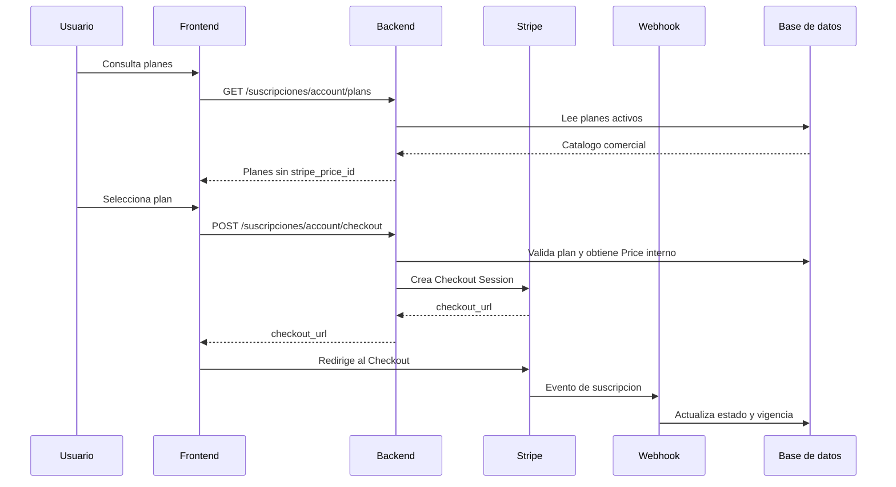

# Analisis de integracion backend para suscripciones Stripe

## 1. Objetivo

Completar el backend requerido por el frontend de suscripciones SaaS. El panel administrativo es la fuente de informacion comercial de los planes; Stripe solo funciona como infraestructura de cobro recurrente.

El backend debe:

- exponer el catalogo de planes activos al usuario autenticado;
- permitir administrar nombre, descripcion, precio, moneda, intervalo y estado;
- resolver internamente el Price de Stripe asociado a cada plan;
- crear Checkout Sessions sin aceptar precios ni identificadores Stripe desde el navegador;
- sincronizar el estado real mediante webhook;
- conservar idempotencia y evitar suscripciones duplicadas.

El frontend relacionado se encuentra en [useSubscriptionStore.js](../src/stores/useSubscriptionStore.js), [SubscriptionCheckout.vue](../src/components/subscriptions/SubscriptionCheckout.vue) y [SubscriptionsView.vue](../src/views/admin/SubscriptionsView.vue).

## 2. Flujo esperado



`checkout=success` solo indica que el usuario regreso de Stripe. El acceso debe depender del webhook y del estado persistido, no de la URL de retorno.

## 3. Modelo de datos

### 3.1 Catalogo de planes

La tabla de planes debe contener como minimo:

| Campo | Tipo sugerido | Reglas |
| --- | --- | --- |
| `id` | entero o UUID | Identificador interno estable |
| `codigo` | varchar | Unico; es el valor enviado como `plan_id` |
| `nombre` | varchar | Texto visible para el usuario |
| `descripcion` | text | Texto visible para el usuario |
| `precio` | decimal | Mayor o igual a cero; usar unidad monetaria definida por el sistema |
| `moneda` | varchar(3) | Codigo ISO, por ejemplo `MXN` |
| `intervalo` | enum/varchar | `month`, `year` o el conjunto aprobado por negocio |
| `estado` | enum/varchar | `active` o `inactive` |
| `stripe_price_id` | varchar | Privado; nunca incluirlo en respuestas publicas |
| `created_at` | datetime | Auditoria |
| `updated_at` | datetime | Auditoria |

Si el proyecto ya tiene una tabla de planes, agregar solo las columnas faltantes y conservar el nombre de la tabla existente. El vinculo con Stripe tambien puede mantenerse en una tabla privada separada por ambiente.

Restricciones recomendadas:

- `codigo` unico.
- `stripe_price_id` unico por ambiente cuando no sea nulo.
- No permitir activar un plan sin Price Stripe valido, salvo que el negocio permita catalogo visible sin checkout.
- No eliminar fisicamente planes usados por suscripciones historicas; marcarlos como `inactive`.
- El precio mostrado por el frontend debe salir del catalogo administrado, no consultarse desde Stripe.

### 3.2 Suscripcion

La suscripcion debe conservar, como minimo:

- `subscription_id`;
- `account_id`;
- `plan_id` o codigo del plan;
- `status`;
- `external_customer_id`;
- `external_subscription_id`;
- `started_at`;
- `current_period_end`;
- `cancel_at_period_end`;
- `canceled_at`;
- `created_at` y `updated_at`.

Las fechas se almacenan en UTC. `cancel_at_period_end` debe salir como booleano JSON, no como `0`, `1`, `"0"` o `"1"`.

## 4. API publica de cuenta

### 4.1 Catalogo activo

```http
GET /suscripciones/account/plans
Cookie: connect.sid=...
Accept: application/json
```

Respuesta:

```json
{
  "data": [
    {
      "id": 1,
      "codigo": "annual",
      "nombre": "Anual",
      "descripcion": "Precio anual con descuento especial",
      "precio": 999,
      "moneda": "MXN",
      "intervalo": "year",
      "estado": "active"
    }
  ]
}
```

No incluir:

- `stripe_price_id`;
- `stripe_product_id` si revela detalles internos;
- `STRIPE_SECRET_KEY`;
- datos de otras cuentas;
- planes inactivos.

El endpoint debe devolver `401` si no hay sesion y `200` con una lista vacia si no existen planes activos. No debe devolver el `index.html` del servidor frontend ni una respuesta HTML.

### 4.2 Inicio de checkout

```http
POST /suscripciones/account/checkout
Cookie: connect.sid=...
Idempotency-Key: checkout-uuid-estable
Content-Type: application/json
```

Body permitido:

```json
{
  "plan_id": "annual"
}
```

El backend debe obtener la cuenta desde la sesion autenticada y resolver el Price internamente:

```text
req.session.user.id
-> cuenta SaaS asociada
-> plan activo por codigo
-> stripe_price_id privado
-> Stripe Checkout Session
```

Respuesta exitosa:

```http
201 Created
```

```json
{
  "data": {
    "checkout_url": "https://checkout.stripe.com/c/pay/cs_test_...",
    "checkout_session_id": "cs_test_...",
    "plan_id": "annual"
  }
}
```

No aceptar desde el navegador:

- `amount`, `price`, `precio`;
- `currency`, `moneda`;
- `stripe_price_id`;
- `account_id`;
- `customer_id`;
- `status`;
- `current_period_end`;
- `entitlements`.

## 5. Validacion y errores

Usar respuestas JSON consistentes:

```json
{
  "error": {
    "code": "INVALID_SUBSCRIPTION_PLAN",
    "message": "El plan solicitado no esta disponible."
  }
}
```

Casos minimos:

| HTTP | Codigo | Condicion |
| --- | --- | --- |
| `400` | `IDEMPOTENCY_KEY_REQUIRED` | Falta la cabecera o tiene formato invalido |
| `401` | `UNAUTHORIZED` | No existe sesion autenticada |
| `404` | `ACCOUNT_NOT_FOUND` | No hay cuenta SaaS asociada |
| `422` | `INVALID_SUBSCRIPTION_PLAN` | `plan_id` desconocido, inactivo o ausente |
| `422` | `PLAN_STRIPE_NOT_CONFIGURED` | El plan activo no tiene Price interno |
| `503` | `STRIPE_UNAVAILABLE` | Stripe no responde o falta configuracion critica |

El `422` original debe investigarse registrando solo codigo, status y request id. No registrar cookies, claves secretas ni payloads completos de Stripe.

## 6. Idempotencia

La misma `Idempotency-Key` debe representar el mismo intento logico de checkout.

Requisitos:

1. Validar longitud y formato de la clave.
2. Asociarla a usuario, cuenta y `plan_id`.
3. Guardar el resultado de la primera operacion.
4. Si llega la misma clave con los mismos parametros, devolver el mismo checkout existente.
5. Si llega la misma clave con parametros diferentes, devolver `409 IDEMPOTENCY_CONFLICT`.
6. No crear dos Checkout Sessions por reintentos de red.
7. Configurar tambien la idempotencia de la llamada al API de Stripe.

## 7. Creacion de Checkout Session

El servicio backend debe construir la sesion con datos controlados por el servidor:

```js
const session = await stripe.checkout.sessions.create({
  mode: 'subscription',
  line_items: [{ price: plan.stripe_price_id, quantity: 1 }],
  customer: account.external_customer_id || undefined,
  success_url: `${frontendUrl}/suscripciones?checkout=success`,
  cancel_url: `${frontendUrl}/suscripciones?checkout=cancelled`,
  metadata: {
    account_id: String(account.id),
    plan_id: plan.codigo
  }
}, {
  idempotencyKey: request.headers['idempotency-key']
})
```

La metadata debe contener identificadores internos no sensibles. El backend debe validar que el Price configurado sea recurrente y corresponda al intervalo esperado antes de crear la sesion.

## 8. Webhook Stripe

Endpoint recomendado:

```http
POST /stripe/subscriptions/webhook
Stripe-Signature: ...
Content-Type: application/json
```

El endpoint debe montarse antes de `express.json` para conservar el body crudo y validar `Stripe-Signature`.

Eventos minimos:

- `checkout.session.completed`;
- `customer.subscription.created`;
- `customer.subscription.updated`;
- `customer.subscription.deleted`.

Procesamiento:

1. Validar firma.
2. Deduplicar por `event.id`.
3. Resolver cuenta por metadata, customer o subscription.
4. Mapear estado Stripe al estado SaaS.
5. Convertir timestamps Unix a UTC.
6. Persistir customer, subscription, vigencia y cancelacion.
7. Invalidar cache de cuenta y entitlements despues del commit.
8. Responder exito solo despues de persistir correctamente.

El webhook es la unica fuente para activar o retirar acceso despues del pago.

## 9. Administracion de planes

El panel administrativo debe poder crear y editar:

```json
{
  "codigo": "annual",
  "nombre": "Anual",
  "descripcion": "Precio anual con descuento especial",
  "precio": 999,
  "moneda": "MXN",
  "intervalo": "year",
  "estado": "active",
  "entitlements": {
    "ct": true
  }
}
```

El backend debe:

- validar permisos de administrador;
- validar codigo unico;
- validar moneda e intervalo;
- validar precio no negativo;
- evitar que un cambio de precio local se interprete como cambio automatico del Price Stripe;
- registrar auditoria con valores anteriores y nuevos;
- impedir editar o eliminar un plan si rompe suscripciones existentes, o aplicar una migracion explicita;
- devolver el registro persistido, no el payload sin confirmar.

Cambiar `precio`, `moneda` o `intervalo` requiere decidir si se crea un nuevo Price en Stripe o si el administrador debe registrar previamente un Price compatible. No se debe modificar silenciosamente el importe de suscripciones activas.

## 10. Cache y consistencia

Despues de modificar planes o suscripciones:

1. confirmar la transaccion;
2. invalidar cache del catalogo si existe;
3. invalidar cache de la cuenta afectada;
4. invalidar entitlements relacionados;
5. leer la proyeccion actualizada;
6. responder con datos persistidos.

Claves de cache sugeridas:

```text
saas:plans:active:v1
saas:subscription:account:{accountId}:v1
saas:entitlements:account:{accountId}:v1
```

El checkout debe volver a validar el plan contra la base de datos aunque el navegador haya cargado previamente el catalogo.

## 11. Pruebas de integracion

### Catalogo

- devuelve solo planes activos;
- devuelve precio, moneda e intervalo administrados;
- no expone `stripe_price_id`;
- devuelve JSON con `Content-Type: application/json`;
- devuelve `401` sin autenticacion;
- invalida cache despues de editar un plan.

### Checkout

- crea checkout con plan mensual, trimestral y anual configurados;
- rechaza `plan_id` ausente, desconocido o inactivo con `422`;
- rechaza un plan sin Price interno con `422`;
- ignora o rechaza precios enviados por el navegador;
- obtiene la cuenta desde la sesion;
- conserva el mismo resultado con la misma Idempotency-Key;
- detecta conflicto si cambia el plan con la misma clave;
- no crea la suscripcion definitiva antes del webhook;
- devuelve `503` sin marcar acceso cuando Stripe no esta disponible.

### Webhook

- rechaza firma invalida;
- procesa cada evento una sola vez;
- actualiza `current_period_end` en UTC;
- convierte correctamente `cancel_at_period_end` a booleano;
- procesa renovacion, `past_due`, cancelacion y eliminacion;
- invalida cache despues del commit;
- conserva auditoria y no pierde eventos repetidos.

## 12. Configuracion de entorno

```env
STRIPE_SECRET_KEY=sk_test_...
STRIPE_SUBSCRIPTION_WEBHOOK_SECRET=whsec_...
FRONTEND_URL=http://localhost:5173
STRIPE_SUBSCRIPTION_SUCCESS_URL=http://localhost:5173/suscripciones?checkout=success
STRIPE_SUBSCRIPTION_CANCEL_URL=http://localhost:5173/suscripciones?checkout=cancelled
```

Los `price_...` pueden almacenarse en una tabla privada por plan y ambiente. No deben ser enviados al frontend ni depender de valores controlados por el cliente.

## 13. Criterio de aceptacion

La integracion backend esta completa cuando:

- `GET /suscripciones/account/plans` devuelve el catalogo administrado en JSON;
- el checkout envia y acepta solamente `plan_id`;
- el backend resuelve el Price internamente;
- los reintentos no duplican Checkout Sessions;
- el webhook confirma y actualiza la suscripcion;
- el acceso no se habilita por `checkout=success`;
- el panel conserva cambios comerciales y audita modificaciones;
- las respuestas usan nombres `snake_case` y tipos JSON estables;
- las pruebas cubren catalogo, `422`, Stripe, webhook, cache e idempotencia.

## 14. Pendientes de implementacion

1. Confirmar la tabla actual de planes y suscripciones.
2. Implementar o verificar `GET /suscripciones/account/plans`.
3. Implementar o corregir `POST /suscripciones/account/checkout`.
4. Definir el almacenamiento privado de `stripe_price_id`.
5. Configurar el Price trimestral antes de activar ese plan.
6. Verificar el webhook y la deduplicacion por `event.id`.
7. Ejecutar pruebas integrales contra Stripe en modo test.
