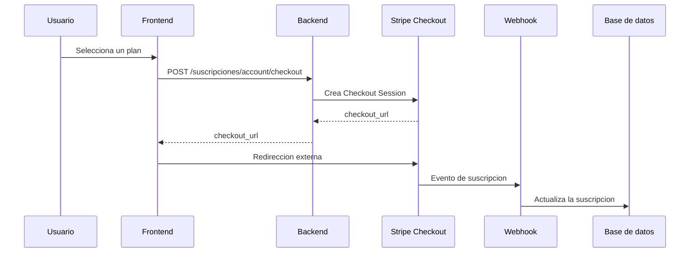
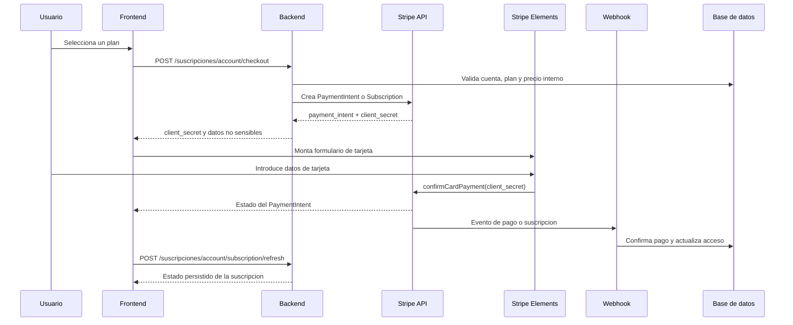

# Analisis de integracion backend para suscripciones con Stripe Elements

## 1. Objetivo

El checkout de suscripciones debe procesar el pago dentro de la aplicacion usando Stripe Elements, siguiendo el patron que ya existe en `src/components/ssaxxonB2B/components/payment/StripeCardForm.vue`.

El flujo anterior devolvia `checkout_url` y enviaba al usuario a Stripe Checkout. El flujo nuevo debe devolver un `client_secret` de un PaymentIntent o de una operacion equivalente administrada por el backend. El navegador nunca crea PaymentIntents, calcula precios ni recibe claves secretas de Stripe.

Archivos frontend relacionados:

- `src/components/subscriptions/SubscriptionCheckout.vue`
- `src/stores/useSubscriptionStore.js`
- `src/components/ssaxxonB2B/components/payment/StripeCardForm.vue` como referencia de Stripe Elements

Los archivos del motor B2B no deben modificarse para implementar este flujo.

## 2. Cambio de arquitectura

### Flujo anterior



### Flujo requerido



El frontend puede mostrar el resultado inmediato de Stripe, pero el acceso definitivo debe depender del webhook y del estado guardado en la base de datos.

## 3. Decision sobre el modelo Stripe

Para una suscripcion recurrente, el backend debe elegir una de estas estrategias y mantenerla consistente:

### Opcion A: Stripe Subscription con PaymentIntent

Recomendada cuando el cobro recurrente inicia inmediatamente:

1. El backend crea o reutiliza un Customer.
2. El backend crea una Subscription usando el Price interno.
3. Stripe genera el PaymentIntent de la primera factura.
4. El backend devuelve el `client_secret` del PaymentIntent pendiente.
5. El frontend confirma el PaymentIntent con Stripe Elements.
6. El webhook confirma la factura y la suscripcion.

Respuesta interna esperada de Stripe:

```text
subscription.latest_invoice.payment_intent.client_secret
```

### Opcion B: PaymentIntent independiente

Solo es valida si el backend tiene una estrategia separada para crear la suscripcion recurrente despues del pago. En ese caso el webhook debe vincular el PaymentIntent con el plan, la cuenta y la suscripcion mediante metadata confiable.

No se debe crear un PaymentIntent independiente si el backend espera que Stripe cree automaticamente la suscripcion sin una operacion posterior.

## 4. Contrato HTTP

### 4.1 Consultar planes

```http
GET /suscripciones/account/plans
Cookie: sesion autenticada
Accept: application/json
```

Respuesta:

```json
{
  "data": [
    {
      "id": 1,
      "codigo": "annual",
      "nombre": "Anual",
      "descripcion": "Precio anual con descuento especial",
      "precio": 999,
      "moneda": "MXN",
      "intervalo": "year",
      "estado": "active"
    }
  ]
}
```

El backend no debe exponer `stripe_price_id`, `stripe_product_id`, claves secretas ni datos de otras cuentas.

### 4.2 Crear el pago de suscripcion

```http
POST /suscripciones/account/checkout
Cookie: sesion autenticada
Idempotency-Key: subscription-checkout-uuid
Content-Type: application/json
Accept: application/json
```

Body permitido:

```json
{
  "plan_id": "annual"
}
```

El backend debe obtener de la sesion:

- `account_id`;
- usuario autenticado;
- correo del cliente;
- permisos para contratar;
- Customer de Stripe asociado, si existe.

El backend debe resolver internamente:

```text
plan_id recibido
-> plan activo de la base de datos
-> stripe_price_id privado
-> Customer de Stripe
-> Subscription o PaymentIntent
-> client_secret
```

Respuesta recomendada:

```http
201 Created
```

```json
{
  "data": {
    "checkout_id": "sub_checkout_123",
    "plan_id": "annual",
    "amount": 99900,
    "currency": "mxn",
    "payment": {
      "provider": "stripe",
      "payment_intent_id": "pi_123",
      "client_secret": "pi_123_secret_456",
      "status": "requires_payment_method"
    }
  }
}
```

El frontend actual acepta estas dos ubicaciones para el secreto:

```json
{ "data": { "client_secret": "..." } }
```

```json
{ "data": { "payment": { "client_secret": "..." } } }
```

Se recomienda usar una sola forma, preferiblemente `data.payment.client_secret`, para evitar contratos ambiguos.

El `client_secret` no debe incluirse en URLs, logs, analytics ni respuestas destinadas a otros usuarios. Aunque puede viajar al navegador, debe tratarse como credencial temporal de alcance limitado.

### 4.3 Consultar suscripcion

```http
GET /suscripciones/account/subscription
Cookie: sesion autenticada
Accept: application/json
```

Respuesta:

```json
{
  "data": {
    "account_id": 25,
    "status": "active",
    "plan": {
      "id": "annual",
      "name": "Anual"
    },
    "current_period_end": "2026-10-04T04:15:00.000Z",
    "access_allowed": true,
    "entitlements": {
      "ct": true
    },
    "limits": {}
  }
}
```

### 4.4 Refrescar despues del pago

```http
POST /suscripciones/account/subscription/refresh
Cookie: sesion autenticada
Accept: application/json
```

Este endpoint puede forzar una lectura de Stripe o de la base de datos, pero no debe marcar una suscripcion como activa solo porque el navegador lo solicite. La fuente de verdad debe ser el evento validado por webhook.

## 5. Validaciones backend

El endpoint de checkout debe validar como minimo:

- sesion autenticada;
- cuenta SaaS existente o creable bajo una transaccion controlada;
- `plan_id` presente y con formato valido;
- plan activo;
- `stripe_price_id` configurado para el ambiente actual;
- moneda e intervalo coherentes con el Price de Stripe;
- ausencia de una suscripcion activa incompatible;
- ausencia de otro checkout pendiente para la misma cuenta y plan;
- clave de idempotencia valida.

Nunca aceptar del cliente:

- `amount`, `price` o `precio`;
- `currency` o `moneda`;
- `stripe_price_id`;
- `customer_id`;
- `account_id`;
- `status`;
- `current_period_end`;
- `access_allowed`;
- `entitlements`.

## 6. Idempotencia y pagos duplicados

La cabecera `Idempotency-Key` enviada por el frontend identifica el intento logico de checkout. El backend debe:

1. Guardar la clave junto con la cuenta, plan y resultado de la operacion.
2. Rechazar la reutilizacion de la misma clave con otro plan o cuenta.
3. Devolver el mismo `client_secret` si la solicitud original ya creo un pago pendiente.
4. Evitar crear dos Customers, Subscriptions o PaymentIntents para el mismo intento.
5. Permitir reintento con una nueva clave cuando el PaymentIntent quedo en `requires_payment_method`.
6. Usar tambien la idempotencia nativa de Stripe al crear recursos.

La clave no debe almacenarse como unico identificador del pago. Debe existir una relacion persistente entre cuenta, plan, checkout interno, PaymentIntent y Subscription.

## 7. Webhook Stripe

El endpoint de webhook debe recibir el cuerpo raw para validar la firma:

```http
POST /webhooks/stripe/subscriptions
Stripe-Signature: t=...,v1=...
Content-Type: application/json
```

Eventos minimos:

| Evento | Accion backend |
| --- | --- |
| `invoice.payment_succeeded` | Activar o mantener la suscripcion y actualizar periodo |
| `invoice.payment_failed` | Marcar pago fallido o suscripcion en riesgo |
| `payment_intent.succeeded` | Registrar el pago confirmado, sin confiar en datos del navegador |
| `payment_intent.payment_failed` | Guardar fallo y permitir reintento |
| `payment_intent.processing` | Mantener estado en procesamiento |
| `customer.subscription.created` | Asociar Subscription con la cuenta |
| `customer.subscription.updated` | Actualizar plan, estado y fechas |
| `customer.subscription.deleted` | Revocar acceso al finalizar la politica definida |

El webhook debe:

- verificar la firma con `STRIPE_SUBSCRIPTION_WEBHOOK_SECRET`;
- guardar `event.id` y procesarlo de forma idempotente;
- localizar la cuenta mediante metadata o IDs almacenados en backend;
- no aceptar `account_id` enviado por el navegador como fuente de verdad;
- confirmar la moneda, monto, Price y entorno antes de actualizar acceso;
- responder rapidamente con `2xx` y procesar tareas pesadas de forma asincrona;
- registrar errores sin guardar secretos ni datos completos de tarjeta.

Metadata recomendada al crear recursos Stripe:

```json
{
  "account_id": "25",
  "plan_id": "annual",
  "checkout_id": "sub_checkout_123",
  "environment": "test"
}
```

## 8. Estados y mapeo

El backend debe conservar los estados nativos de Stripe y mapearlos a estados de negocio separados:

| Stripe | Negocio | Comportamiento frontend |
| --- | --- | --- |
| `requires_payment_method` | `pending_payment` | Mostrar formulario y permitir intento |
| `requires_action` | `payment_action_required` | Permitir la autenticacion 3DS que Stripe solicite |
| `processing` | `payment_processing` | Mostrar espera, sin activar acceso definitivo |
| `succeeded` | `paid` | Esperar confirmacion persistida/webhook |
| `canceled` | `payment_canceled` | Permitir iniciar un nuevo checkout |
| `payment_failed` | `payment_failed` | Mostrar error seguro y permitir reintento |
| `active` | `active` | Permitir acceso segun entitlements |
| `past_due` | `past_due` | Aplicar la politica de gracia del negocio |
| `canceled` en Subscription | `expired` o `canceled` | Revocar acceso segun fecha y politica |

No marcar la cuenta como `active` solo porque `confirmCardPayment` devolvio una respuesta exitosa en el navegador. La confirmacion del proveedor debe persistirse por webhook o por una verificacion backend confiable.

## 9. Seguridad

- Mantener `STRIPE_SECRET_KEY` exclusivamente en backend.
- Publicar solo `VITE_STRIPE_PUBLIC_KEY` al frontend.
- Usar Stripe Elements para que los datos completos de tarjeta no atraviesen la aplicacion.
- Configurar CORS y cookies con credenciales para el dominio permitido.
- Validar CSRF si la autenticacion usa cookies de sesion.
- No guardar numeros de tarjeta, CVC ni datos equivalentes.
- No registrar `client_secret`, cookies, Authorization headers ni payloads sensibles.
- Separar recursos de test y produccion.
- Confirmar que el Price pertenece al mismo ambiente y producto esperado.
- Aplicar control de acceso por cuenta en todos los endpoints.

## 10. Compatibilidad y migracion

El frontend ya no usa `window.location.assign(checkout_url)` para suscripciones. Por eso, una respuesta que contenga solamente `checkout_url` debe considerarse incompatible con el checkout integrado.

Plan de migracion:

1. Mantener el catalogo de planes y su `stripe_price_id` privado.
2. Agregar la creacion de Subscription/PaymentIntent al endpoint existente.
3. Devolver `client_secret` en el contrato nuevo.
4. Mantener temporalmente una bandera de configuracion por ambiente si se requiere rollback.
5. Probar pagos exitosos, tarjetas rechazadas, 3DS, cancelacion y reintentos.
6. Activar y verificar el webhook antes de habilitar acceso real.
7. Retirar el contrato de `checkout_url` cuando todos los clientes frontend usen Elements.

No se recomienda modificar `StripeCardForm.vue` del modulo B2B para resolver diferencias de suscripciones. El backend debe entregar el contrato correcto y la vista de suscripciones ya reutiliza ese formulario sin copiar su logica de ordenes.

## 11. Errores esperados

Usar JSON consistente:

```json
{
  "error": {
    "code": "INVALID_SUBSCRIPTION_PLAN",
    "message": "El plan solicitado no esta disponible."
  }
}
```

| HTTP | Codigo | Situacion |
| --- | --- | --- |
| `400` | `IDEMPOTENCY_KEY_REQUIRED` | Falta la cabecera o tiene formato invalido |
| `400` | `INVALID_REQUEST` | Body mal formado |
| `401` | `UNAUTHORIZED` | No existe sesion valida |
| `403` | `SUBSCRIPTION_FORBIDDEN` | La cuenta no puede contratar |
| `404` | `ACCOUNT_NOT_FOUND` | No existe cuenta SaaS |
| `422` | `INVALID_SUBSCRIPTION_PLAN` | Plan ausente, inactivo o desconocido |
| `422` | `PLAN_STRIPE_NOT_CONFIGURED` | No existe Price interno para el ambiente |
| `409` | `SUBSCRIPTION_ALREADY_ACTIVE` | Ya existe una suscripcion incompatible |
| `409` | `CHECKOUT_ALREADY_PENDING` | Existe un intento pendiente reutilizable |
| `502` | `STRIPE_API_ERROR` | Stripe rechazo la operacion |
| `503` | `STRIPE_UNAVAILABLE` | Stripe o configuracion critica no disponible |

El backend no debe devolver mensajes de Stripe sin filtrar si contienen informacion sensible o detalles internos. El frontend usa `error.code` para presentar mensajes seguros.

## 12. Criterios de aceptacion

- [ ] `GET /suscripciones/account/plans` devuelve solo planes activos y datos comerciales permitidos.
- [ ] `POST /suscripciones/account/checkout` no acepta precios ni IDs Stripe del navegador.
- [ ] La respuesta exitosa contiene `client_secret` directo o `payment.client_secret`.
- [ ] El backend crea o reutiliza el recurso Stripe de forma idempotente.
- [ ] El PaymentIntent o Subscription contiene metadata suficiente para localizar la cuenta.
- [ ] Se valida la firma del webhook con el cuerpo raw.
- [ ] Los eventos webhook son idempotentes por `event.id`.
- [ ] El acceso se activa por estado persistido y no por una respuesta del navegador.
- [ ] Se manejan `requires_action`, `processing`, `succeeded`, `failed` y `canceled`.
- [ ] Los pagos duplicados y los reintentos tienen una politica definida.
- [ ] No se registran `client_secret`, claves secretas ni datos de tarjeta.
- [ ] Se prueban los ambientes test y produccion con Prices separados.
- [ ] La aplicacion compila y el formulario Stripe se monta solo cuando existe `client_secret`.

## 13. Diagnostico del log recibido

### Evidencia

Los eventos recibidos fueron aceptados por Stripe y verificaron correctamente la firma:

| Evento | Resultado observable |
| --- | --- |
| `customer.created` | Customer creado para `account_id: 2` |
| `payment_intent.created` | PaymentIntent creado, pero sin metadata |
| `invoice.created` | Invoice creada, pero sin metadata |
| `invoice.finalized` | Invoice finalizada |
| `customer.updated` | Customer actualizado para `account_id: 2` |
| `customer.subscription.created` | Subscription creada con `plan_id`, `price_version_id`, `account_id` y entorno |

Por lo tanto, el mensaje `Stripe no pudo preparar el metodo de pago` no corresponde a un fallo de firma ni a un rechazo del endpoint webhook. El log termina con `Webhook processed OK` en todos los eventos mostrados. El fallo ocurre probablemente en el endpoint que crea el checkout o en la respuesta que debe devolver el `client_secret` al frontend.

### Causa mas probable

El backend esta creando una Subscription correctamente, pero no esta entregando al frontend el PaymentIntent de la primera factura. Para Stripe Elements, crear la Subscription no es suficiente: el frontend necesita exactamente el secreto del PaymentIntent que se encuentra en:

```text
subscription.latest_invoice.payment_intent.client_secret
```

El backend debe crear la Subscription con un comportamiento que deje la primera factura pendiente de confirmacion y debe expandir o recuperar el PaymentIntent. Por ejemplo, conceptualmente:

```js
const subscription = await stripe.subscriptions.create({
  customer: customerId,
  items: [{ price: stripePriceId }],
  payment_behavior: 'default_incomplete',
  payment_settings: {
    save_default_payment_method: 'on_subscription'
  },
  metadata: {
    account_id: String(accountId),
    plan_id: String(planCode),
    checkout_id: String(checkoutId),
    environment: stripeEnvironment
  },
  expand: ['latest_invoice.payment_intent']
})

const paymentIntent = subscription.latest_invoice?.payment_intent
const clientSecret = paymentIntent?.client_secret
```

Si `latest_invoice` o `payment_intent` llegan como un ID en vez de un objeto expandido, el backend debe recuperarlos explícitamente antes de responder. No debe intentar leer `client_secret` de un string.

### Segunda causa posible: exigencia incorrecta de metodo por defecto

Un Customer nuevo no tiene por qué tener un PaymentMethod por defecto antes del primer pago. El flujo esperado es:

1. Backend crea Customer y Subscription incompleta.
2. Backend devuelve `client_secret` del PaymentIntent.
3. Stripe Elements recopila la tarjeta.
4. `confirmCardPayment(client_secret, { payment_method })` confirma el pago.
5. Stripe guarda el método como default para cargos recurrentes futuros cuando la configuración lo permite.

Si el backend intenta buscar `customer.invoice_settings.default_payment_method` antes de crear la Subscription y, si no existe, devuelve `Stripe no pudo preparar el metodo de pago`, está bloqueando incorrectamente el flujo Elements. Ese método debe ser opcional durante el primer checkout.

### Anomalia de metadata

El evento `customer.subscription.created` sí contiene metadata, pero `payment_intent.created`, `invoice.created` e `invoice.finalized` llegan con `{}`. Esto no impide necesariamente el primer pago, pero sí dificulta localizar la cuenta cuando se procese un webhook de PaymentIntent o Invoice.

El backend debe propagar metadata al recurso que realmente recibe el evento o correlacionar siempre por IDs persistidos:

- guardar `customer_id`, `subscription_id`, `invoice_id` y `payment_intent_id` en la base de datos;
- agregar metadata al PaymentIntent cuando se crea o actualizarla explícitamente;
- agregar metadata a la Invoice cuando la API lo permita;
- en el webhook de Invoice, usar `invoice.subscription` para recuperar la Subscription y su metadata;
- en el webhook de PaymentIntent, usar metadata propia o una tabla de correlación por `payment_intent_id`.

No se debe asumir que la metadata de la Subscription aparece automáticamente en el PaymentIntent o en la Invoice.

### Error del log: `Intent ID`

El campo mostrado como `Intent ID` no es siempre un PaymentIntent:

- `cus_...` identifica un Customer;
- `pi_...` identifica un PaymentIntent;
- `in_...` identifica una Invoice;
- `sub_...` identifica una Subscription.

El logger debe llamarlo `Object ID` o imprimir campos separados:

```text
Event type: invoice.created
Object type: invoice
Object ID: in_...
PaymentIntent ID: pi_...  // si existe
Subscription ID: sub_...  // si existe
Customer ID: cus_...      // si existe
```

Esta corrección evita diagnosticar una Invoice como si fuera un PaymentIntent.

### Verificaciones inmediatas en backend

Agregar temporalmente logs seguros, sin imprimir `client_secret`, para la respuesta de creación:

```text
checkout_id
account_id
customer_id
subscription_id
latest_invoice_id
payment_intent_id
subscription_status
payment_intent_status
has_client_secret: true|false
```

Comprobar específicamente:

1. `subscription.status` debe ser normalmente `incomplete` o el estado esperado antes de confirmar el primer pago.
2. `latest_invoice` debe existir.
3. `latest_invoice.payment_intent` debe existir para el primer cobro con tarjeta.
4. `payment_intent.status` debe ser `requires_payment_method` o `requires_action`, no `succeeded` prematuramente.
5. `has_client_secret` debe ser `true` antes de responder `201`.
6. La respuesta HTTP debe contener `data.payment.client_secret`.
7. El frontend no debe recibir solo `checkout_url` ni un PaymentIntent ID sin su secreto.

### Correccion recomendada

El endpoint `POST /suscripciones/account/checkout` debe tratar como error interno la ausencia del secreto, pero después de recuperar los recursos Stripe, no después de crear una Subscription que queda abandonada:

```text
crear o reutilizar checkout idempotente
-> crear o recuperar Customer
-> crear o recuperar Subscription incompleta
-> expandir/recuperar latest_invoice
-> expandir/recuperar PaymentIntent
-> validar client_secret
-> guardar IDs y estados en DB
-> responder data.payment.client_secret
```

Si la creación termina sin `client_secret`, el backend debe guardar el estado como pendiente, devolver un código diagnosticable como `PAYMENT_INTENT_NOT_READY` y permitir reutilizar el intento mediante la misma `Idempotency-Key`. No debe crear una nueva Subscription en cada reintento.

### Conclusión

Con la evidencia disponible, Stripe no está rechazando el webhook. La infraestructura de webhook funciona. La causa más probable es un contrato incompleto entre el endpoint de checkout y el frontend: la Subscription se crea, pero el PaymentIntent de su primera factura no se expande, no se recupera o no se devuelve como `client_secret`. La ausencia de metadata en PaymentIntent e Invoice es un problema adicional de trazabilidad que debe corregirse antes de depender de esos eventos para activar la suscripción.
