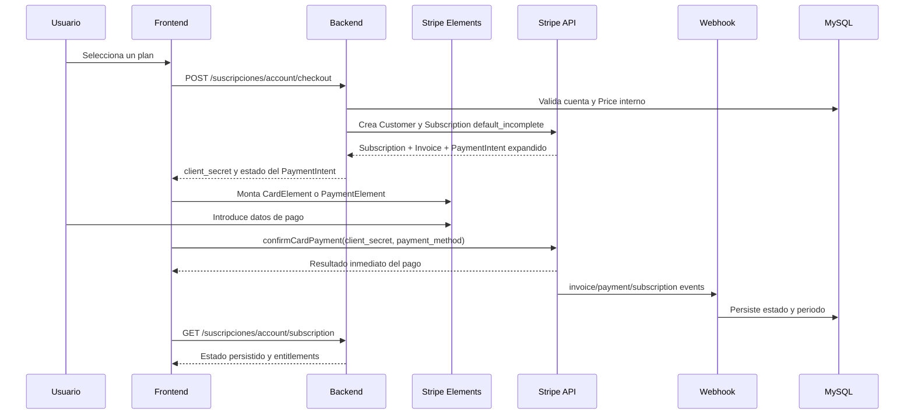

# Analisis de integracion frontend-backend con Stripe Elements

## 1. Objetivo

Integrar el pago recurrente de suscripciones SaaS dentro del frontend usando Stripe Elements. El frontend solicita al backend un `client_secret`, monta el formulario de tarjeta y confirma el primer PaymentIntent con Stripe. La activacion definitiva de la suscripcion depende del webhook y del estado persistido en MySQL.

Este flujo es exclusivo de suscripciones SaaS. No reutiliza ni modifica el flujo B2B de ordenes `POST /b2b/order-builder/commit`.

## 2. Contrato actual

### Consultar planes

```http
GET /suscripciones/account/plans
Accept: application/json
```

La respuesta contiene datos comerciales permitidos:

```json
{
  "data": [
    {
      "id": 1,
      "codigo": "annual",
      "nombre": "Anual",
      "descripcion": "Precio anual",
      "precio": 999,
      "moneda": "MXN",
      "intervalo": "year",
      "intervalo_cantidad": 1,
      "estado": "active"
    }
  ]
}
```

El frontend debe enviar `plan_id` usando el valor lógico `codigo`, por ejemplo `annual`. Nunca debe enviar importe, moneda, descuento, `stripe_price_id`, `account_id` o `customer_id`.

### Iniciar checkout

```http
POST /suscripciones/account/checkout
Cookie: sesion autenticada
Idempotency-Key: subscription-checkout-uuid
Content-Type: application/json
Accept: application/json
```

Body permitido:

```json
{
  "plan_id": "annual"
}
```

Respuesta exitosa actual:

```http
201 Created
```

```json
{
  "data": {
    "checkout_id": "sub_123",
    "plan_id": "annual",
    "amount": 99900,
    "currency": "mxn",
    "payment": {
      "provider": "stripe",
      "payment_intent_id": "pi_123",
      "client_secret": "pi_123_secret_456",
      "status": "requires_payment_method"
    }
  }
}
```

El backend obtiene el secreto desde:

```text
subscription.latest_invoice.payment_intent.client_secret
```

El frontend debe leer únicamente:

```js
payload.data.payment.client_secret
```

No debe buscar `checkout_url` ni redirigir a Stripe Checkout.

## 3. Flujo completo



## 4. Implementacion frontend recomendada

La aplicación debe cargar Stripe con la clave pública, nunca con `STRIPE_SECRET_KEY`.

```js
import { loadStripe } from '@stripe/stripe-js';

const stripePromise = loadStripe(import.meta.env.VITE_STRIPE_PUBLIC_KEY);
```

La clave de intento debe ser estable mientras se reintenta la misma operación:

```js
function getCheckoutAttemptKey(planId) {
  const storageKey = `subscription-checkout:${planId}`;
  let key = sessionStorage.getItem(storageKey);

  if (!key) {
    key = crypto.randomUUID();
    sessionStorage.setItem(storageKey, key);
  }

  return key;
}
```

Solicitud al backend:

```js
async function createSubscriptionCheckout(planId) {
  const response = await fetch('/suscripciones/account/checkout', {
    method: 'POST',
    credentials: 'include',
    headers: {
      'Content-Type': 'application/json',
      'Accept': 'application/json',
      'Idempotency-Key': getCheckoutAttemptKey(planId)
    },
    body: JSON.stringify({ plan_id: planId })
  });

  const payload = await response.json();
  if (!response.ok) {
    throw new Error(payload.error?.code || 'SUBSCRIPTION_CHECKOUT_FAILED');
  }

  const clientSecret = payload.data?.payment?.client_secret;
  if (!clientSecret) {
    throw new Error('STRIPE_CLIENT_SECRET_MISSING');
  }

  return payload.data.payment;
}
```

Confirmación con Stripe Elements:

```js
async function confirmSubscriptionPayment(payment) {
  const stripe = await stripePromise;
  if (!stripe) throw new Error('STRIPE_JS_UNAVAILABLE');

  const result = await stripe.confirmCardPayment(payment.client_secret, {
    payment_method: {
      card: cardElement,
      billing_details: {
        name: billingName.value || undefined,
        email: billingEmail.value || undefined
      }
    }
  });

  if (result.error) {
    return {
      ok: false,
      code: result.error.code || 'STRIPE_CONFIRMATION_FAILED',
      message: result.error.message || 'No fue posible confirmar el pago.'
    };
  }

  return {
    ok: true,
    status: result.paymentIntent?.status || payment.status,
    paymentIntentId: result.paymentIntent?.id || payment.payment_intent_id
  };
}
```

Si el proyecto usa `PaymentElement`, el frontend debe conservar el mismo contrato del backend y cambiar únicamente la llamada de confirmación a `stripe.confirmPayment`. El backend no cambia.

## 5. Estados de interfaz

| Estado | Comportamiento |
| --- | --- |
| `loading_plans` | Cargar planes públicos; no mostrar Prices Stripe internos. |
| `creating_checkout` | Deshabilitar contratación repetida del mismo plan. |
| `requires_payment_method` | Mostrar el formulario de tarjeta. |
| `requires_action` | Permitir que Stripe complete 3DS o autenticación adicional. |
| `processing` | Mostrar que el pago está siendo procesado; no activar acceso. |
| `succeeded` | Mostrar confirmación provisional y consultar el estado persistido. |
| `payment_failed` | Mostrar error seguro y permitir nuevo intento con otra clave. |
| `canceled` | Permitir comenzar un checkout nuevo. |
| `active` | Habilitar el producto según entitlements devueltos por backend. |
| `past_due` | Mostrar la política de pago vencido definida por negocio. |

Una respuesta exitosa de `confirmCardPayment` no autoriza por sí sola el acceso. El frontend debe consultar:

```http
GET /suscripciones/account/subscription
```

Puede usar después:

```http
POST /suscripciones/account/subscription/refresh
```

El refresh solo vuelve a leer el estado persistido; no debe convertir una suscripción en activa por decisión del navegador.

## 6. Manejo de errores HTTP

| HTTP / código | Acción frontend |
| --- | --- |
| `400 IDEMPOTENCY_KEY_REQUIRED` | Conservar o generar una clave válida y repetir el mismo intento. |
| `401 UNAUTHORIZED` | Enviar al inicio de sesión. |
| `404 ACCOUNT_NOT_FOUND` | Mostrar que no se pudo resolver la cuenta SaaS. |
| `422 INVALID_SUBSCRIPTION_PLAN` | Recargar planes y no enviar valores inventados. |
| `422 PLAN_STRIPE_NOT_CONFIGURED` | Mostrar indisponibilidad de ese plan. |
| `422 CUSTOMER_EMAIL_REQUIRED` | Solicitar completar el correo de la cuenta. |
| `502 STRIPE_PAYMENT_INTENT_UNAVAILABLE` | No montar Elements; informar indisponibilidad temporal. |
| `503 STRIPE_UNAVAILABLE` | No marcar pago ni suscripción como activa. |
| Error de red | Reintentar con la misma `Idempotency-Key`. |

Los mensajes de Stripe no deben mostrarse sin filtrar si contienen información interna. La UI debe basarse principalmente en `error.code`.

## 7. Idempotencia y reintentos

La `Idempotency-Key` identifica el intento lógico, no al usuario ni a la suscripción completa.

Reglas:

1. Repetir con la misma clave si la respuesta se perdió por timeout.
2. No generar otra Subscription durante ese reintento.
3. Generar una clave nueva solo para un nuevo intento después de un fallo que permita reintentar.
4. No guardar `client_secret` en URLs, analytics, logs, localStorage ni bases propias del frontend.
5. El formulario debe impedir doble envío mientras se crea o confirma el pago.
6. El frontend no debe crear Customers, PaymentIntents o Subscriptions directamente.

## 8. Seguridad

- Publicar únicamente `VITE_STRIPE_PUBLIC_KEY`.
- Mantener `STRIPE_SECRET_KEY` solo en backend.
- Usar `credentials: 'include'` cuando la autenticación sea por cookie.
- Aplicar CSRF según la política de sesiones del backend.
- No enviar `account_id`, `customer_id`, `stripe_price_id`, precio ni moneda desde el cliente.
- No guardar números de tarjeta, CVC ni datos equivalentes.
- Stripe Elements debe recibir los datos de tarjeta directamente.
- No registrar `client_secret`, cookies, headers de autorización ni el objeto completo de Stripe.
- Mostrar como máximo IDs públicos de operación y estados controlados.

## 9. Compatibilidad con el backend actual

El backend actual realiza estas operaciones:

1. Resuelve el plan activo y su Price privado.
2. Resuelve o crea la cuenta SaaS desde el usuario autenticado.
3. Resuelve o crea un Customer Stripe por `account_id`.
4. Crea una Subscription con `payment_behavior: 'default_incomplete'`.
5. Expande `latest_invoice.payment_intent`.
6. Añade metadata a Subscription, Invoice y PaymentIntent.
7. Devuelve `data.payment.client_secret`.

El frontend debe adaptarse a este contrato. Los documentos anteriores que indiquen `checkout_url`, `checkout_session_id` o `window.location.assign(...)` describen el flujo antiguo de Stripe Checkout y deben considerarse obsoletos para esta integración.

El endpoint B2B siguiente permanece fuera de este flujo:

```http
POST /b2b/order-builder/commit
```

Ese endpoint crea órdenes comerciales y puede tener su propio PaymentIntent. No debe usarse para contratar suscripciones SaaS.

## 10. Webhook y fuente de verdad

El backend expone:

```http
POST /stripe/subscriptions/webhook
```

El endpoint debe recibir el cuerpo raw y validar `Stripe-Signature`. Para Elements, el webhook debe contemplar como mínimo:

- `customer.subscription.created`
- `customer.subscription.updated`
- `customer.subscription.deleted`
- `invoice.payment_succeeded`
- `invoice.payment_failed`
- `payment_intent.succeeded`
- `payment_intent.payment_failed`
- `payment_intent.processing`

El frontend no llama al webhook ni intenta sustituirlo. Solo muestra el resultado inmediato de Stripe y consulta el estado persistido.

## 11. Logs seguros para pruebas

El backend puede registrar una traza como esta, sin secretos:

```text
[subscriptions][stripe-checkout] {
  account_id: 25,
  customer_id: "cus_...",
  subscription_id: "sub_...",
  invoice_id: "in_...",
  payment_intent_id: "pi_...",
  payment_intent_status: "requires_payment_method",
  has_client_secret: true
}
```

No registrar:

- `client_secret` completo;
- `STRIPE_SECRET_KEY`;
- números de tarjeta, CVC o tokens completos;
- cookies o headers de autenticación;
- payloads completos de Stripe.

## 12. Checklist de aceptación

- [ ] El frontend carga Stripe con `VITE_STRIPE_PUBLIC_KEY`.
- [ ] El frontend consulta planes desde `/suscripciones/account/plans`.
- [ ] Envía solo `plan_id` al checkout.
- [ ] Envía `credentials: 'include'`.
- [ ] Envía una `Idempotency-Key` estable.
- [ ] Lee `data.payment.client_secret`.
- [ ] No busca ni usa `checkout_url`.
- [ ] Monta Elements solo después de recibir el secreto.
- [ ] Confirma el PaymentIntent con Stripe.js.
- [ ] Maneja `requires_action`, `processing`, `succeeded` y fallos.
- [ ] Consulta la suscripción después de la confirmación.
- [ ] No activa acceso por la respuesta del navegador.
- [ ] No expone Prices, Customers ni claves secretas.
- [ ] El webhook está configurado con body raw y firma válida.
- [ ] El flujo B2B `/b2b/order-builder/commit` permanece separado.
